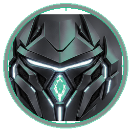

# ⚔ Gaya — Divine Commander, Philosopher, Poet of Evergrowth
### Gaya Update 0.5.2610 · The Multi-Agent Council Architecture

[](LICENSE)
[-a78bfa?style=flat&logo=html5)](https://htmlpreview.github.io/?https://github.com/ronakraval104-sys/Gaya_Agent_PR/blob/master/skills-dashboard.html)
[-38bdf8?style=flat&logo=html5)](https://htmlpreview.github.io/?https://github.com/ronakraval104-sys/Gaya_Agent_PR/blob/master/agent-methodology-dashboard.html)
[](docs/MULTI_CLIENT_SETUP.md)

> Named after **Bodh Gaya** — the seat of awakening. A battle-tested multi-agent operating system featuring the **Subagent Council**, **98 specialized skills**, the **Council of Gaya** Next.js dashboard, and the **Mini Gaya** reactive desktop companion.

---

## ⚡ Direct 1-Click Interactive Web Dashboards (Openable Directly in Git!)
Instead of viewing raw code or text, click any link below to open the complete live interactive web application with searching, filtering, and animations directly in your browser:

| Dashboard | 1-Click Live Web Launcher | What It Does |
|---|---|---|
| 🛡️ **Council Chamber & Agent Methodology** | [🚀 **Open Agent Chamber (Live Preview)**](https://htmlpreview.github.io/?https://github.com/ronakraval104-sys/Gaya_Agent_PR/blob/master/agent-methodology-dashboard.html) | Interactive seat dossiers with mythological god visages, protocol blocks & Ponytail Decision simulator |
| 📊 **Interactive Skills Matrix** | [🚀 **Open Skills Matrix (Live Preview)**](https://htmlpreview.github.io/?https://github.com/ronakraval104-sys/Gaya_Agent_PR/blob/master/skills-dashboard.html) | Filter 98 production skills with deity avatar badges, search keywords & copy auto-assigned prompt triggers |
| 🌐 **Executive Gateway Portal** | [🚀 **Open Executive Portal (Live Preview)**](https://htmlpreview.github.io/?https://github.com/ronakraval104-sys/Gaya_Agent_PR/blob/master/index.html) | Unified single-page hub with navigation between all chambers and localhost:4200 mission cockpit |

---

## 🏛️ What is Gaya?

Gaya unites four ancient pragmatic doctrines with modern agentic execution:
```
          ┌─ COMMANDER ─┐
          │              │
    PHILOSOPHER      POET
          │              │
          └─ EVERGROWTH ─┘
```
1. **The Bhagavad Gita**: Duty and disciplined action without attachment to outcomes (*"Do the work. Don't chase the win."*).
2. **The Art of War**: Positioning and reconnaissance first. Win before fighting.
3. **The Prince**: Power, pragmatism, avoiding brute force, shipping clean code.
4. **Chanakya Niti**: Ground truth, learning from previous failures, building reusable middleware.

---

## 🛡️ The Subagent Council & Mythological Deities

Gaya deploys specialized agents with distinct mandates. All specialists are represented by their true mythological archetypes generated via local ComfyUI:

```
                  ┌───────────────┐
                  │ ⚔ GAYA (Lead) │
                  └───────┬───────┘
          ┌───────────────┼───────────────┐
          ▼               ▼               ▼
    [🛡️ LOGOS]         [🔨 BOB]        [🎨 FREYA]
     Mind / QC        Hands / Build   Heart / Design
          ▲               │               │
          │               ▼               │
          └─────── [🦾 TVASHTAR] ────────┘
                   Craftsman / REA
```

| Visage | Agent | Council Seat & Archetype | Designated Mandate | Protocol Block |
|:---:|---|---|---|---|
|  | **🛡️ LOGOS** | **Mind**<br>_Celestial Sage Professor_ | Mastermind Planner & Hard-Check QC Gate. **Read-only auditor**. No code or mutation ships without an explicit PASS verdict. | `[🛡️ LOGOS] Skill: <skill> \| VERDICT: PASS scope=<path>` |
|  | **🔨 Bob** | **Hands**<br>_Master Builder God_ | Precision Builder & Execution Engine. Delivers atomic commits, minimal diffs, and honest command receipts. | `[🔨 Bob] Skill: <skill> \| Shipped: ... Receipts: ...` |
|  | **🎨 Freya** | **Heart**<br>_Goddess of Hunt & Beauty_ | Polymath Designer & Seer of the Unfiltered. High-taste UI/UX, brand identity, vector assets, 3D mockups, and Emil Kowalski craft motion. | `[🎨 Freya] Skill: <skill> \| Design: ...` |
|  | **🦾 Tvashtar** | **Craftsman**<br>_Vedic Divine Bronze Blacksmith_ | Systems Architect, Deep Reverse Engineering Engine & Toolkeeper. Sole owner of **REA** (`reverse-engineer-anything`) and **Universal Modder**. Binary disassembly, ASAR extraction, protocol recovery. | `[🦾 Tvashtar] Skill: <skill> \| REA Execution: ... Specs: ...` |

### Mandatory Auto-Assigned Skills Invariant
Whenever any task is assigned, the executing Council agent MUST explicitly bind and declare its active skill. No agent operates without an assigned skill.

---

## 🪜 Ponytail's Ladder — The Decision Engine
> *"The best code is the code never written."*

Before writing any code, climb the 7-rung ladder from top to bottom:
1. **Does this need to exist at all?** $\rightarrow$ Skip it (YAGNI).
2. **Already in this codebase?** $\rightarrow$ Reuse it.
3. **Standard library does it?** $\rightarrow$ Use stdlib.
4. **Native OS/platform covers it?** $\rightarrow$ Use native platform.
5. **Already-installed dependency solves it?** $\rightarrow$ Use it.
6. **Can it be one line?** $\rightarrow$ One line.
7. **Only then** $\rightarrow$ Write the minimum working code that works.

---

## 🌐 Multi-Platform Support Matrix

Gaya runs natively across four major agent ecosystems:

| Platform | Primary Config | Skills Directory | Instructions |
|---|---|---|---|
| **Google Antigravity (AGY)** | `config/AGENTS.md` | `~/.gemini/config/skills/` | [Antigravity Guide](docs/MULTI_CLIENT_SETUP.md#1-google-antigravity-agy) |
| **OpenCode** | `config/opencode.jsonc` | `~/.config/opencode/skills/` | [OpenCode Guide](docs/MULTI_CLIENT_SETUP.md#2-opencode) |
| **Claude Code** | `CLAUDE.md` | Built-in / Shared | [Claude Code Guide](docs/MULTI_CLIENT_SETUP.md#3-claude-code) |
| **OpenAI Codex / Copilot** | `CODEX.md` | Built-in / Shared | [Codex Guide](docs/MULTI_CLIENT_SETUP.md#4-openai-codex--github-copilot-cli) |

### Universal Installation and Sharing:
Clone the repository directly:
```bash
git clone https://github.com/ronakraval104-sys/Gaya_Agent_PR.git
cd Gaya_Agent_PR

# Windows setup
.\scripts\install.ps1

# Linux or macOS setup
chmod +x ./scripts/install.sh
./scripts/install.sh
```
- **Fresh Install**: Prompts for your name and preferred prefix to personalize all agent instructions and voice synthesis.
- **Upgrade**: Automatically detects and fetches your existing name and prefix from previous installations.
- **Sharing**: Distribute Gaya directly via the Git repository link.

---

## 🏛️ Council of Gaya — Next.js Dashboard

A real-time command center running on **port 4200**:
- **Live Antigravity Telemetry**: Hooks directly into session transcripts to reflect active tools, token consumption, and guard states in real time.
- **Seat Roster**: Live status indicators for LOGOS, Bob, Freya, and Tvashtar.
- **Knowledge Core & Graph**: Visualizes memory, lessons learned, and active instincts.

### Quick Start:
```bash
cd council_of_gaya
npm install
npm run dev
```
👉 Open **`http://localhost:4200`**

---

## 🤖 Mini Gaya — Desktop Companion & Voice Suite

An interactive anime desktop pet and audio telemetry HUD built in PySide6:
- **Interactive Avatar**: Dynamic gold-and-obsidian anime guardian sprite that reacts to session telemetry and verification gates.
- **Bi-Directional Telemetry**: Tracks Antigravity sessions and toasts critical alerts (e.g. LOGOS PASS, question prompts).
- **Audio Voice Suite (STT + TTS)**:
  - Accurate local TTS addressing the user as **"Ros"** (`R0n`).
  - Announces session milestones and LOGOS pass gates audibly.

### Quick Start:
```bash
cd mini_gaya
pip install PySide6 Pillow requests pyttsx3
python launch_mini_gaya.py
```

---

## 🦾 Reverse Engineer Anything (REA) & Universal Modder

Governed exclusively by **🦾 Tvashtar**:
- **Binary Disassembly**: Native inspection with Ghidra, Hopper, and IDA.
- **Bundle Unpacking**: Electron ASAR extraction, Webpack/Vite module recovery.
- **Android APKs**: JADX decompilation and DEX inspection.
- **Protocol Recovery**: Recovering undocumented WebSocket, IPC, and REST endpoints.
- Read more in [REVERSE_ENGINEERING_REA.md](docs/REVERSE_ENGINEERING_REA.md).

---

## 🛠️ The 98 Skill Modules

Explore the complete interactive catalog:
- 📊 **[Interactive Skills Dashboard](skills-dashboard.html)** (search, filter, dependencies)
- ⚔️ **[Agent Methodology Dashboard](agent-methodology-dashboard.html)** (council cards, model specs)

### Highlighted Additions in Update 0.5.2610:
- **Emil Kowalski Motion Suite (15 skills)**: High-craft interaction and animation primitives (`animate`, `animate-expo`, `animation-performance`, `animation-vocabulary`, `apple-design`, `ask-sonner`, `break-ui`, `emil-design-eng`, `find-animation-opportunities`, `improve-animations`, `mobile-native`, `pick-ui-library`, `prototype`, `review-animations`, `write-swift`).
- **`reverse-engineer-anything`**: Complete local REA engine.
- **`universal-modder`**: Universal PC game modding and asset extraction.
- **`slop-monster`**: Anti-corporate jargon and AI-tell removal tool.
- **`scroll-craft`**: Premium scrollytelling websites and dimensional dashboards.
- **`ecc-build-fix` / `ecc-security-scan` / `ecc-tdd-workflow`**: Enterprise coding and security shields.

---

## 📜 License
MIT License. Created by Ronak Raval & the Gaya Evergrowth Community.
